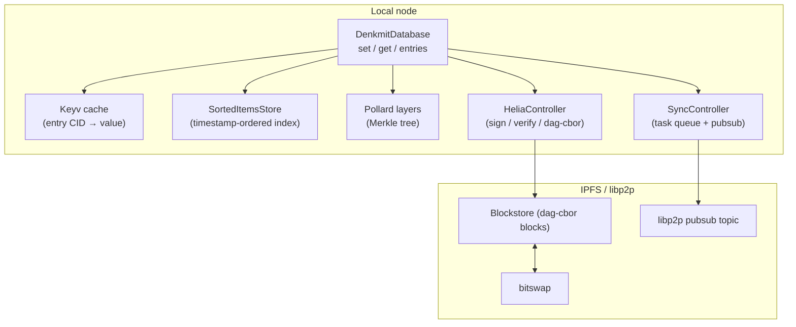
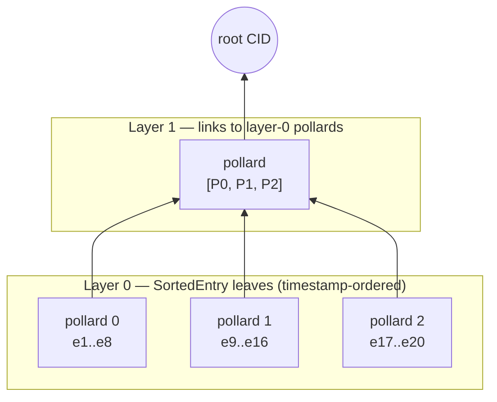

# DenkMitDB Architecture

DenkMitDB is a distributed key-value database built on [IPFS](https://ipfs.tech/)
(via [Helia](https://github.com/ipfs/helia)) and [libp2p](https://libp2p.io/). All
state lives in immutable, content-addressed dag-cbor blocks. Entries, heads,
manifests, policies and identities are additionally **signed** (JWS);
pollards — the Merkle index nodes — are **not** (see the trust model below).
Replicas converge by exchanging a single CID (the "head") over libp2p pubsub and
diffing Merkle trees to find what they are missing.

## The big picture



## Data model

Persisted objects are **dag-cbor** blocks. Entries, heads, manifests and
policies are wrapped in a **flattened JWS** (signed with the writer's identity key,
`kid` = identity CID); identities are self-signed with an embedded JWK; **pollards
are stored unsigned** — their integrity comes from content addressing only. The
building blocks:

| Object | File | Contents | Role |
|---|---|---|---|
| **Identity** | `src/identity.ts` | name, key type, algorithm (default ES384), public key (JWK, base64) | Self-certifying signer identity. Stored as a self-signed JWS (embedded JWK); its CID is the identity's address. The private key lives only in the local datastore, encrypted with a passphrase (PBES2). |
| **Entry** | `src/entry.ts` | version (2), **manifest** (the database address), timestamp (`Date.now()` ms), key, value — or `deleted: true` for a tombstone | One write. Immutable; an update to a key is a brand-new entry. The signed manifest field binds it to one database (KNOWN_ISSUES.md #24); v1 entries without it are accepted only by legacy v1 databases. |
| **Pollard** | `src/pollard/pollard.ts` | version, order, leaves + hash layers | A **Merkle subtree** ("pollard" in the code) of fixed capacity: `subtreeLeaves` leaves, fixed in the manifest at creation (a power of two in [2, 256], default 8; stored as `order` = log2). Stored **unsigned**. The database's full tree is built from many pollards stacked in layers. |
| **Leaf** | `src/pollard/leaf.ts` | type + payload | Tree node payload. Types: `Empty`, `Hash`, `Pollard` (link to child pollard), `Entry`, `Identity`, `SortedEntry` (entry CID + sort key + db key + creator). |
| **Head** | `src/head.ts` | manifest CID, tree root CID, timestamp, layer count, size | A snapshot pointer: "my database state is the tree rooted at X". This is the only thing peers broadcast. |
| **Manifest** | `src/manifest.ts` | version (2), name, type, subtree order (API `subtreeLeaves` = 2^order), the consensus rules — access-policy CID (`access`) and validity-policy CID (wire key `consensus`) — creation timestamp | The database descriptor. **Its CID is the database address.** Immutable — changing any field creates a different database. |
| **Policy** | `src/policy.ts` | name, description, [json-logic](https://jsonlogic.com/) rule | The two **consensus rules** of a database: **access** (who may write which key) and **validity** (which authorized entries are valid). Evaluated on every local write and every ingested entry, over deterministic inputs only — `entryCreator` (the writer), `databaseCreator`, `entryKey`, `entryOperation` (put / delete), and `entryTimestamp` for validity. Only a literal `true` accepts ([docs/policies.md](docs/policies.md)). |
| **Encrypted value** | `src/encryption.ts` | `{ denkmitEncrypted: 1, jwe }` — a General JSON JWE | Not a separate block type: an ordinary entry value sealed to one or more recipient identities (AES-256-GCM body, ECDH-ES+A256KW key per recipient), bound to its database, key and writer as authenticated data. |

### In-memory state (not persisted)

- **`SortedItemsStore`** (`src/storage/sortedItems.ts`) — the canonical
  index: an ordered map keyed by the composite key `(timestamp, entry CID)` plus a
  key→record map holding the last-write-wins winner for each key. Determines
  iteration order and feeds tree building.
- **Pollard layers** (`DenkmitDatabase.layers`) — layer 0 holds pollards whose leaves
  are `SortedEntry` records; each higher layer holds pollards whose leaves link to the
  pollards below; the top layer has a single pollard, whose CID is the **root**.
- **Keyv cache** — **entry CID → value** cache so `get` doesn't refetch entry blocks.
  Content-addressed, so a cached value can never be stale and one Keyv can be shared
  by several databases (KNOWN_ISSUES.md #30); a superseded record's value is deleted
  when a newer one wins. By default in-memory; a caller-supplied (possibly persistent)
  Keyv is never `clear()`ed by the database (D4).

The index and layers are rebuilt, not stored: the database persists only the CID
of its last head in the Helia datastore (on `createHead()`, on the periodic
announcement and on `close()`). `openDatabase()` fetches the manifest and
consensus rules and, if a head pointer exists, restores from it through the same
authenticated path as a remote announcement — so a node reopens its own state with
no live peer, given persistent block/data stores (KNOWN_ISSUES.md D4, #28). The
value cache fills lazily on `get()`.

## The Merkle tree (a forest of subtrees, "pollards")

Entries are sorted by timestamp and packed into layer-0 pollards (Merkle subtrees), `subtreeLeaves` at a time.
Layer 1 packs the CIDs of layer-0 pollards, and so on, until one pollard remains:



Because entries are timestamp-sorted, an insert at timestamp *t* only invalidates the
pollard containing *t* and everything to its right (`updateLayers` starts rebuilding
from the affected pollard, not from scratch), plus the spine above.

Two replicas holding the same entry set produce the same root CID regardless of the
order in which they learned the entries — that is what makes head comparison
meaningful. This holds because entries are ordered by the composite key
`(timestamp, entryCID)` (`specs/ordering.md`): a total order with no collisions,
per-key last-write-wins that is independent of merge order, and full-metadata leaf
equality so the diff can't hide a difference.

## Write path (`db.set`)

1. Check the access policy for the signing identity (the database's own, or `WriteOptions.identity`); create and sign an `Entry` block bound to this database's address (`manifest`, entry v2); add + pin it in the blockstore.
2. Run the validity rule over the same deterministic inputs every replica will see on merge; reject the write unless it returns literal `true`.
3. Insert `(timestamp → key, entryCID, creator)` into `SortedItemsStore` and the value into the Keyv cache under the entry CID.
4. Enqueue a `updateLayers(timestamp)` task on the single-concurrency sync queue (tree building is asynchronous — readers see the entry immediately, the tree catches up).

## Read path (`db.get`)

1. Look the key up in `SortedItemsStore` to find the winning entry CID (absent or a
   tombstone → no value).
2. Return the value cached under that CID if present; otherwise fetch the entry block
   (bitswap fetches from peers transparently if it isn't local), verify its signature,
   cache it under the CID and return it.

## Sync protocol

The pubsub topic is derived from the manifest **CID** (`syncTopic`), so databases
that share a name never share a topic. A node publishes its head CID after a change
and re-announces it every 30 s even when nothing changed, so peers that connect
later still converge (KNOWN_ISSUES.md #21). Heads are accepted only when bound to
this database's manifest and format version and plausible in shape (layer count,
size), and the remote tree is walked under a per-head budget that rejects repeated
or misshapen pollards (KNOWN_ISSUES.md #26).

```mermaid
sequenceDiagram
    participant A as Node A
    participant B as Node B
    A->>A: set(k, v), rebuild layers
    A->>B: pubsub: head CID
    B->>A: bitswap: fetch head + differing pollards
    B->>B: compare(head): walk both trees top-down,<br/>descend only into differing branches
    B->>A: bitswap: fetch each differing entry block
    B->>B: verify signature, index the SIGNED key/timestamp/creator,<br/>rebuild layers from the earliest change
    Note over B: leaf metadata is untrusted; a leaf whose entry fails<br/>verification or whose claims are forged is ignored
    Note over A,B: roots now equal → future compares stop at the root
```

`compare` walks the two trees in lockstep from the root. Equal node hashes prune the
whole branch; only differing leaves are returned. Within one pollard the work is
O(diff · order); a full database comparison additionally descends the differing
spine of the layer tree and fetches each differing pollard block over the network,
so the realistic bound is O(diff · order · tree-height) plus those block fetches —
still independent of total database size, which is the core idea of the design.

`merge` fetches and **signature-verifies** each incoming `SortedEntry`'s entry
block, then indexes the *signed* key/timestamp/creator — the leaf's own claims are
untrusted (pollards are unsigned) and are never used for indexing. A leaf whose
entry is missing, fails verification, or is rejected by the access or validity rule is
skipped. Records are resolved by last-write-wins on the composite key, and layers
are rebuilt once from the earliest change. A node whose database is empty takes the
`load` path: it walks the remote tree, authenticates every entry the same way, then
rebuilds its own honest tree from the verified index.

## Trust model

- **Authentication — entries, heads, manifests, policies**: these blocks are
  JWS-signed; `kid` is the CID of the writer's identity, itself a self-signed,
  content-addressed block. Verification fetches the identity (over bitswap if
  needed) and checks the signature. Tampering with any *fetched-and-verified* block
  is detectable.
- **Authentication — the index is covered too**: pollards are unsigned, but merge
  never trusts them. Every incoming leaf's entry block is fetched and its signature
  verified, and indexing uses the *signed* key/timestamp/creator, not the leaf's
  claims. Forged leaf metadata is ignored, and heads are accepted only when bound to
  this database's manifest and format version (KNOWN_ISSUES.md #10, #11). Content
  addressing guarantees you got the bytes the sender meant; the signature check adds
  that an honest identity actually authored them.
- **Database binding**: every current entry names its database inside the signed
  payload, so an entry (or tombstone) cannot be replayed from one database into
  another that shares a writer (KNOWN_ISSUES.md #24). Signed payloads are also
  shape-checked before use — a valid signature only proves who wrote the bytes.
- **Authorization (consensus rules)**: the manifest names a deterministic access
  policy and a validity policy, evaluated on both local writes and merge/load. Presets:
  `creator-only` (default), `public`, `prefix-per-writer`, `namespace-per-writer`
  (every identity, the creator included, writes only under `agents/<its-cid>/`),
  identity allowlists — or custom json-logic over the signer, key and operation.
  Because the rules use only deterministic inputs and live in the signed manifest,
  every replica reaches the same decision (KNOWN_ISSUES.md D1, #25). Policies are
  immutable; delegation of write rights is specified in a draft
  (`specs/delegation.md`, not yet merged).
- **Reads are not access-controlled**: anyone who knows a database address and can
  reach a peer can replicate it. Confidentiality comes from encrypting values to
  recipient identities (`encryptValueFor`); the key, writer, time, recipients and
  size stay visible.
- **Conflict resolution**: last-write-wins on the composite key
  `(timestamp, entryCID)` — a deterministic total order with per-key LWW and
  superseded-record removal (`specs/ordering.md`, KNOWN_ISSUES.md #2, #3, fixed in
  Phase 2). The remaining caveat is wall-clock trust: a writer with a fast clock
  wins conflicts for the duration of its skew (D3).

## Deployment: daemon, thin client, seeds

The MCP package (`mcp/`) ships two deployment shapes over the same database code:

- **`denkmitd`** — one long-lived node per machine: Helia with filesystem stores,
  libp2p on a fixed TCP port (default 4001), the device identity, optional
  per-agent identities (`DENKMIT_AGENTS`), and the database. It serves one MCP
  session per connection on owner-only Unix sockets (`denkmitd.sock` for the device
  identity, `denkmitd-<agent>.sock` per agent).
- **`denkmit-mcp`** — a stdio MCP server that pipes to the daemon when its socket
  answers, and otherwise boots an embedded node for the lifetime of the session.

Peers find each other by direct dial (`DENKMIT_PEERS`), mDNS on a LAN, or a file
rendezvous on one machine. A **seed** is just a daemon on a reachable host: it has
no special authority, verifies and stores entries like any replica, and keeps data
available while other peers are offline. Discovery by database address over a DHT
and NAT traversal through libp2p relays are next on the roadmap.

## Source layout

```
src/
├── index.ts              # the package entry: exactly the public API, by name
├── types.ts              # public contracts: Database, options, Identity, Manifest, Policy…
├── internal.ts           # every module, for tests/bench (not in package exports)
├── database.ts           # DenkmitDatabase: set/get/iterate, tree building, merge
├── entry.ts              # signed key-value write records
├── identity.ts           # key generation, JWS sign/verify, JWE encrypt/decrypt
├── encryption.ts         # values sealed to recipients (General JWE)
├── manifest.ts           # database descriptor (the address)
├── head.ts               # replication snapshot pointer
├── policy.ts             # json-logic evaluation of the consensus rules (access, validity)
├── sync.ts               # pubsub subscription + serialized task queue
├── protocol/             # wire formats: versioned signed payloads, shape checks, leaf tags
├── pollard/              # Merkle subtree + leaf codecs
└── storage/
    ├── helia.ts          # HeliaStorage/HeliaController: dag-cbor + JWS plumbing
    └── sortedItems.ts    # timestamp-ordered in-memory index
test/                     # vitest suites; *.integration.* spin up real libp2p nodes;
                          # test/wire freezes the wire format (byte/CID fixtures)
mcp/src/                  # MCP server: tools.ts (tool surface), node.ts (node setup),
                          # daemon.ts (denkmitd), index.ts (thin client / embedded),
                          # smoke*.ts and demo.ts
```

## Design notes & trade-offs

- **Why timestamps as sort keys?** They give a total order that every replica agrees
  on without coordination, which makes tree construction deterministic. The composite
  key `(timestamp, entryCID)` removes same-millisecond collisions; the remaining price
  is wall-clock trust — a writer with a fast clock wins its own key's conflicts for
  the length of its skew (D3). Under `namespace-per-writer`, parties never share keys,
  so that skew cannot shadow anyone else's facts.
- **Why pollards instead of one big Merkle tree?** Fixed-size subtrees are natural
  storage/transfer units: a diff transfers only the pollards on the changed spine, and
  append-heavy workloads only rewrite the rightmost pollard per layer.
- **Why is the tree built asynchronously?** Hashing the tree spine on every `set`
  would serialize writes. Instead each write updates the index and cache
  synchronously and enqueues the tree rebuild on a single-concurrency queue; `set()`
  returns once the entry is indexed, and the head catches up when the queue drains
  (`db.waitUntilIdle()`). Rebuilds are **coalesced**: a burst of writes lowers the start key of
  the one queued rebuild instead of queuing many. Rebuild failures are caught and
  logged rather than left as unhandled rejections (KNOWN_ISSUES.md #14).
